


  

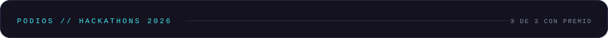

<a href="https://lulo-ia.vercel.app/">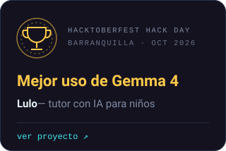</a>
<a href="https://gotocloud.vercel.app/">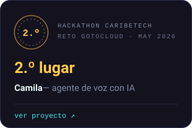</a>
<a href="https://la-vaca-hackaton.vercel.app/">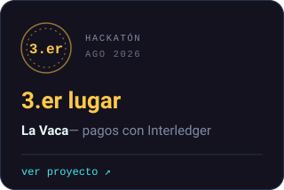</a>

  

<a href="https://lulo-ia.vercel.app/">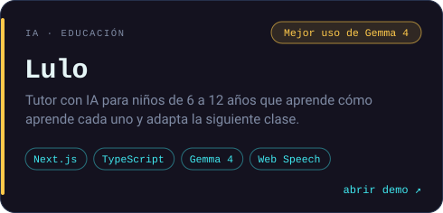</a>
<a href="https://gotocloud.vercel.app/">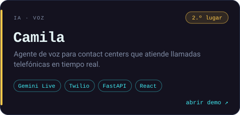</a>
<a href="https://la-vaca-hackaton.vercel.app/">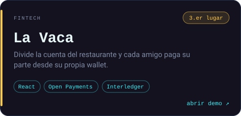</a>
<a href="https://panello-eight.vercel.app">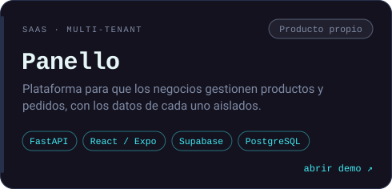</a>
<a href="https://grandpa-burgers.vercel.app/">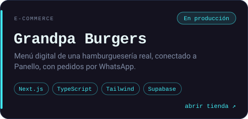</a>
<a href="https://github.com/srhanscho/kart-test">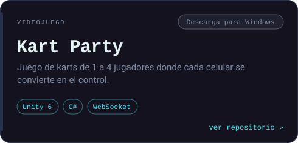</a>

  


  

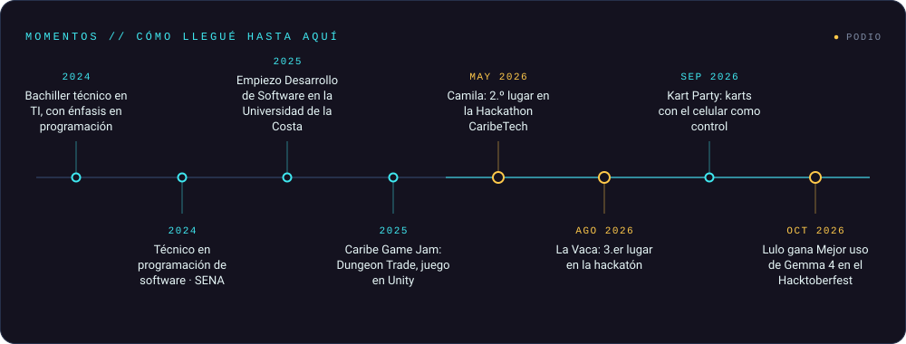

  

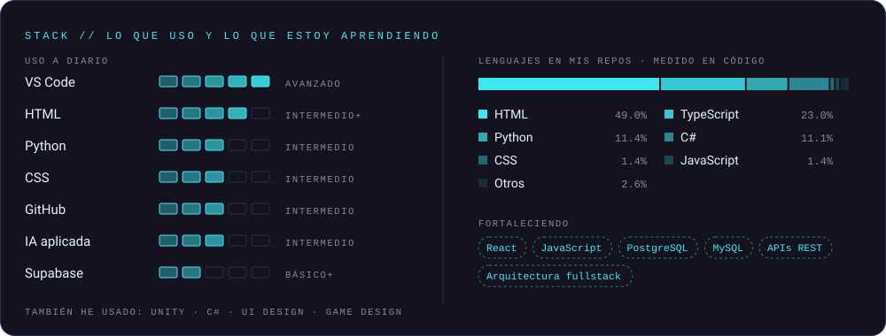

